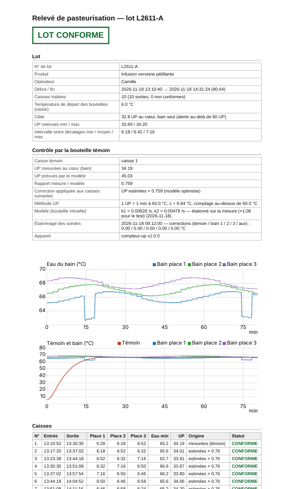
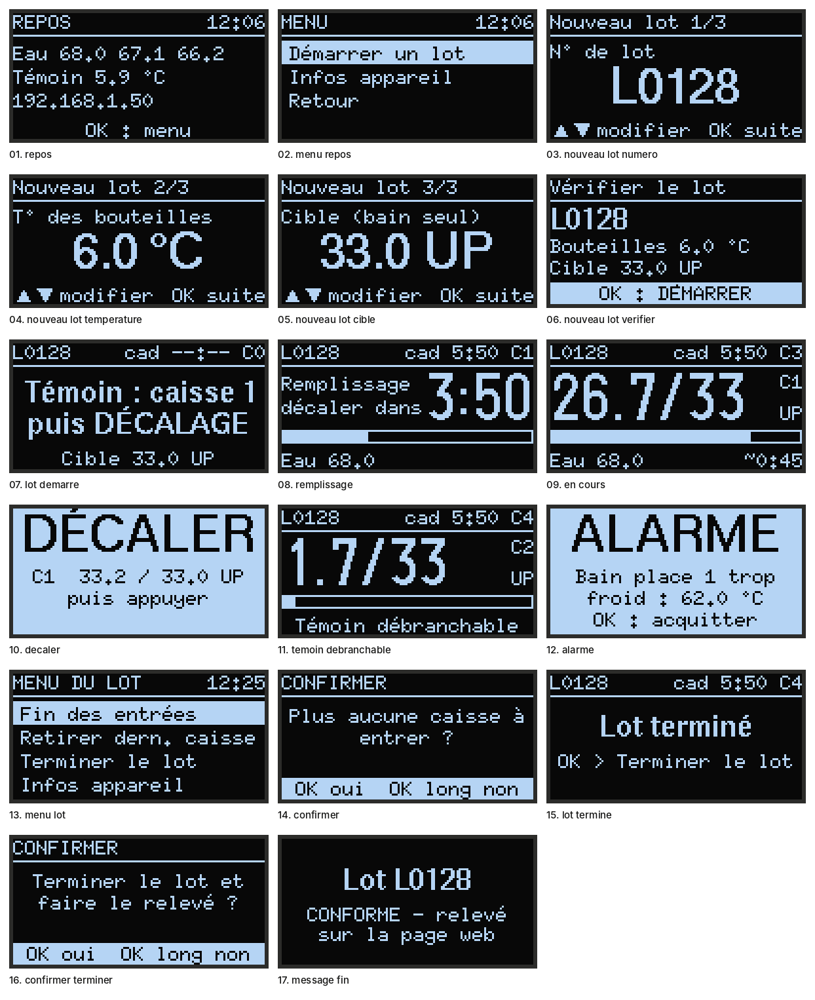

# compteur-up — compteur d'unités de pasteurisation open source (ESP32)

Un appareil simple et peu coûteux (≈ 120 € de matériel) pour **mesurer et piloter la pasteurisation en bouteille** dans un bain-marie conduit comme un tunnel manuel. Il s'inspire du *Pasteurization Computer* de Craft Metrics.

- Une **bouteille témoin** remplie d'eau, avec une sonde au cœur, mesure les **UP réelles**. Formule : 1 UP = 1 min à 60 °C, z = 6,94 °C.
- **Trois sondes dans le bain**, une par place du tunnel, alimentent une **bouteille virtuelle** pour chaque caisse. L'appareil indique **quand décaler** : dès que la caisse en sortie a atteint la cible.
- La caisse témoin sert de **contrôle réel à chaque lot**. Si le modèle s'avère trop optimiste, la cible des caisses suivantes est **durcie automatiquement**. Elle n'est jamais assouplie.
- **Relevé de fin de lot** pour la traçabilité : page imprimable ou PDF, plus des CSV (températures, UP de chaque caisse, événements, statut CONFORME / NON CONFORME).
- **Utilisable sans téléphone** : écran OLED 2,42", **gros bouton « DÉCALAGE »** et trois boutons **▲ ▼ OK** pour démarrer un lot (n° auto-incrémenté), corriger un appui et terminer le lot. Buzzer, page web locale, **notifications facultatives sur téléphone (ntfy)**, reprise automatique après une coupure de courant.



> ⚠️ **Responsabilité.** Cet appareil est un outil de mesure et d'aide à la décision fait maison, sans certification. La **cible d'UP** et la **méthode** doivent être validées dans votre plan HACCP : essais, analyses, avis d'un laboratoire ou d'un centre technique. L'exploitant reste responsable de la sécurité de ses produits. Voir [docs/haccp.md](docs/haccp.md).

## Fonctionnement en bref

```
            ┌──────── bain-marie (tunnel manuel, 3 places) ────────┐
 sortie  ◄──│  Place 3 (sortie)  │  Place 2  │  Place 1 (entrée)  │◄── entrée
            │   sonde bain 3     │ sonde 2   │   sonde bain 1     │
            └──────────────────────────────────────────────────────┘
   caisse 1 du lot : bouteille témoin (sonde au cœur) → UP réelles
   autres caisses : bouteille virtuelle calculée avec l'eau de leur place
```

| Mode | À quoi il sert |
|---|---|
| **Mesure** (essais) | Le témoin traverse le tunnel. Chaque appui sur le bouton le fait avancer d'une place. Vous obtenez les UP « bain seul » et « bain + air » de votre procédé. Un clic **étalonne le modèle** sur cette courbe. |
| **Session** (un lot) | Vous saisissez le n° de lot, la température des bouteilles et la cible. Le témoin va dans la 1re caisse. L'appareil suit chaque caisse et sonne **« DÉCALER »** quand la caisse en sortie atteint la cible. À la fin : relevé + CSV. |

## L'écran de l'appareil

Captures produites par le vrai code du firmware (`tests/test_ecrans.cpp`) :



## Contenu du dépôt

| Dossier | Contenu |
|---|---|
| `firmware/compteur_up/` | Firmware ESP32 (Arduino). S'ouvre directement dans l'IDE Arduino. |
| `firmware/platformio.ini` | Pour compiler avec PlatformIO (facultatif). |
| `firmware/bin/` | Firmware précompilé, à flasher sans rien installer. |
| `docs/` | Matériel, câblage, installation, utilisation, principe de calcul, HACCP. |
| `docs/exemples/` | Relevés d'exemple (lot et mesure), générés par le firmware en simulation. |
| `tests/` | Tests sur PC du calcul et simulation complète d'un lot. |

## Démarrage rapide

Télécharger le projet : `git clone https://github.com/auborddulit/compteur-UP.git` (ou *Code → Download ZIP* sur GitHub).

1. Acheter le matériel : [docs/materiel.md](docs/materiel.md).
2. Câbler : [docs/cablage.md](docs/cablage.md).
3. Flasher le firmware et faire la première configuration : [docs/installation.md](docs/installation.md).
4. Étalonner les sondes, faire des mesures d'essai, étalonner le modèle, fixer la cible : [docs/utilisation.md](docs/utilisation.md).
5. Comprendre le calcul et ses limites : [docs/principe.md](docs/principe.md).
6. Imprimer et plastifier la **fiche opérateur** (A4), à accrocher près du bain : [docs/fiche-operateur.pdf](docs/fiche-operateur.pdf). Avant l'impression, compléter le nom et le téléphone du responsable.

## Licence

Code et documentation sous licence **MIT** (voir [LICENSE](LICENSE)). Contributions bienvenues.
