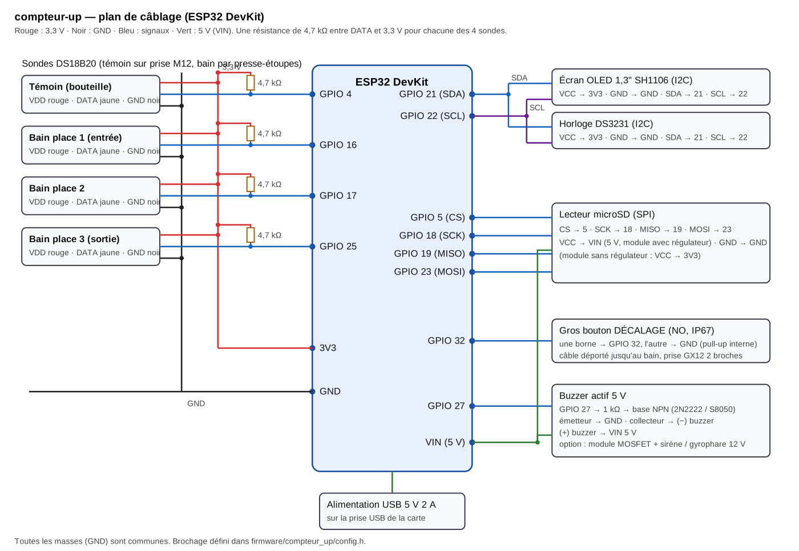

# Câblage

(Version vectorielle : [cablage.svg](cablage.svg).)

## Tableau des connexions

| Élément | Broche élément | Broche ESP32 | Remarque |
|---|---|---|---|
| Sonde **témoin** | DATA (jaune) | **GPIO 4** | 4,7 kΩ entre DATA et 3,3 V |
| Sonde **bain place 1** (entrée, droite) | DATA | **GPIO 16** | 4,7 kΩ |
| Sonde **bain place 2** | DATA | **GPIO 17** | 4,7 kΩ |
| Sonde **bain place 3** (sortie, gauche) | DATA | **GPIO 25** | 4,7 kΩ |
| Toutes les sondes | VDD (rouge) / GND (noir) | 3V3 / GND | **Alimentation 3 fils** (pas de mode parasite) |
| OLED SH1106 | SDA / SCL / VCC / GND | 21 / 22 / 3V3 / GND | Adresse I2C 0x3C |
| DS3231 | SDA / SCL / VCC / GND | 21 / 22 / 3V3 / GND | Adresse I2C 0x68 (module : EEPROM en 0x57, sans conflit) |
| Lecteur microSD | CS / SCK / MISO / MOSI | 5 / 18 / 19 / 23 | VCC sur VIN (5 V) si le module a un régulateur |
| Bouton DÉCALAGE | contact NO | **GPIO 32** et GND | Pull-up interne, anti-rebond logiciel |
| Buzzer | via NPN | **GPIO 27** | 1 kΩ dans la base ; buzzer entre 5 V et le collecteur |

Les couleurs des fils des sondes varient selon les fabricants. Vérifiez avec la fiche du vendeur, ou au multimètre (le fil relié à la gaine inox est en général le GND).

## Pourquoi une broche par sonde ?

Chaque sonde a son propre bus 1-Wire. L'appareil sait donc **quelle sonde est où d'après sa prise**, sans adresse à configurer. Vous pouvez échanger une sonde défectueuse sans rien régler (pensez juste à refaire son étalonnage). Une sonde en panne ne perturbe pas les autres.

## Conseils de montage

- **Témoin sur prise M12** (IP67, 4 broches codée A, 3 utilisées : 1 = VDD, 3 = GND, 4 = DATA) : on le débranche pour le ranger en chambre froide. **Capuchon vissé dès que la prise est libre** : elle n'est étanche que fermée. Les **3 sondes de bain** sont fixes et passent par des presse-étoupes, avec une étiquette (B1, B2, B3) sur chaque câble.
- Soudez les **résistances de 4,7 kΩ côté boîtier**, sur la plaque à pastilles.
- **Câbles longs** : jusqu'à environ 5 m par sonde, aucun souci avec 4,7 kΩ. En cas de lectures « absente » intermittentes, passez à 2,2 kΩ.
- Mettez le **boîtier à l'abri des projections**, au-dessus du niveau du bain, et branchez l'alimentation USB sur une prise protégée par un différentiel 30 mA.
- **Bouton DÉCALAGE** : à fixer à portée de main, côté sortie des caisses. Il fonctionne mains mouillées (IP67).
- **Sondes de bain** : une face au centre de chaque place, à mi-hauteur des bouteilles, à environ 2 cm de la paroi, sans toucher les caisses. Elles ne doivent pas se trouver dans le jet direct d'arrivée d'eau chaude.

## Variante : sirène ou gyrophare 12 V

Si le buzzer n'est pas assez fort dans l'atelier :
1. Remplacez le transistor par un **module MOSFET** (ex. IRLZ44N ou AO3400, commande logique 3,3 V).
2. Branchez une **sirène ou un gyrophare 12 V** avec son alimentation 12 V, en reliant les masses.

Le motif (bip par seconde pour « DÉCALER », triple bip pour une alarme) reste le même.
