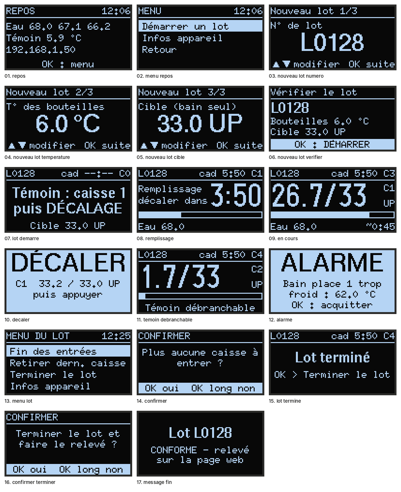

# Utilisation

Ordre conseillé à la mise en service : **étalonner les sondes → essai à blanc → mesures d'essai → étalonner le modèle → fixer la cible → sessions de production.**

## 1. Étalonner les sondes (à la mise en service, puis chaque mois)

1. Plongez **toutes les sondes et le thermomètre de référence** ensemble dans le bain à ~65 °C, dans une zone brassée, pointes rapprochées (un élastique suffit).
2. Attendez **3 minutes** que les valeurs soient stables.
3. Onglet **Étalonnage** (mot de passe administrateur déjà saisi dans *Réglages*) :
   - saisissez la température lue sur la référence ;
   - cochez les sondes à corriger ;
   - cliquez sur *Calculer et enregistrer*.
4. La correction (référence − valeur brute) est appliquée à toutes les mesures suivantes. La date d'étalonnage figure sur chaque relevé.

Un écart supérieur à ±3 °C est refusé : la sonde est défectueuse. **Chaque mois**, refaites la comparaison sans enregistrer. Si un écart dépasse 0,2 °C, refaites l'étalonnage et notez-le dans le plan HACCP.

## 2. Essai à blanc (une fois)

Sans produit, avec une caisse de bouteilles d'eau :
1. Lancez une **session** « TEST ».
2. Faites quelques décalages au bouton et testez *Annuler*, *Fin des entrées*, *Acquitter*.
3. Débranchez l'alimentation 1 minute en cours de session, puis rebranchez : la session doit reprendre, avec un événement « Reprise après redémarrage » dans le journal.
4. Clôturez, puis ouvrez le **relevé** et les **CSV** depuis l'onglet *Session* ou *Historique*. Imprimez en PDF depuis le téléphone.

## 3. Mesures d'essai (mode Mesure)

Le mode Mesure enregistre les **UP réelles** reçues par le témoin, avec **votre cadence actuelle**.

1. Bain à température. Onglet **Mesure** : notez les conditions (cadence, réglage du bain, position du témoin), puis *Démarrer*.
2. Placez le témoin dans la caisse, à la position la plus défavorable.
3. **Appui 1** quand la caisse entre en place 1, **appui 2** au décalage vers la place 2, **appui 3** vers la place 3, **appui 4** à la sortie du bain. Le minuteur de décalage nominal (6 min 40) bipe pour vous aider à garder la cadence.
4. Laissez la mesure tourner pendant le passage à l'air si vous voulez aussi les UP « bain + air », puis *Arrêter la mesure*.

Vous obtenez :
- **UP bain seul** : la valeur de référence ;
- **UP bain + air** : utile pour comprendre le procédé, mais **non comptées** en production (marge de sécurité) ;
- la **prévision du modèle actuel**, pour voir s'il est juste.

**Faites au moins 3 mesures** à des moments différents : bain en début de chauffe, en milieu de journée, cuve en bas de son hystérésis. Gardez la plus faible.

**Trouver la bouteille la plus lente** (à faire une fois, puis à chaque changement de l'installation)

Le témoin de production doit occuper la place de la caisse qui reçoit **le moins d'UP**. On la cherche à la main, en mode Mesure, en déplaçant le témoin d'un passage à l'autre :

1. Choisir 3 ou 4 places candidates : le **centre** de la caisse, un **coin côté arrivée d'eau chaude**, un **coin à l'opposé**, et le milieu d'un **bord long**.
2. Faire **au moins 2 passages par place**, en **alternant** les places (A, B, C, A, B, C…) plutôt que de les enchaîner. Le bain oscille de ±1 °C avec le thermostat de la cuve ; alterner évite qu'une place tombe toujours sur un bain plus chaud.
3. Garder la même cadence, le même chargement de caisse (24 bouteilles) et des bouteilles à la même température de départ.
4. Comparer les **UP bain** moyennes. La place la plus basse devient la position du témoin. Notez-la dans le plan HACCP, avec une photo.

Si deux places sont à moins de 10 % l'une de l'autre, l'écart est dans le bruit : prenez la plus défavorable des deux, ou refaites un passage de chaque.

**Quand refaire cette recherche** : la place la plus lente ne bouge pas tant que l'installation reste la même. Elle peut changer si l'on modifie :
- le sens ou l'endroit d'arrivée de l'eau chaude (c'est prévu avec le système 2, arrivée côté sortie) ;
- le débit de la pompe ;
- le niveau d'eau ;
- le modèle de caisse ;
- le format de bouteille.

## 4. Étalonner le modèle

La « bouteille virtuelle » doit chauffer comme votre bouteille réelle.

1. Onglet **Historique** : sur la mesure la plus représentative, cliquez sur *calibrer*. Vous pouvez aussi utiliser le bouton sous la dernière mesure, dans l'onglet *Mesure*.
2. L'appareil cherche les coefficients k1, k2 qui reproduisent le mieux la courbe du témoin, puis affiche :
   - l'**écart moyen** entre modèle et témoin (bon si < 0,5 °C) ;
   - les **UP mesurées** et les **UP prévues** par le nouveau modèle (elles doivent être proches) ;
   - les UP prévues par le modèle actuel, pour comparer.
3. Cliquez sur *Appliquer ce modèle*. Le mot de passe administrateur est requis. L'origine et la date sont reportées sur les relevés.
4. **Vérifiez** avec une autre mesure : la prévision du modèle doit tomber à ±10 % des UP mesurées.

Refaites l'étalonnage si vous changez de bouteille, de niveau de bain, de débit de circulation, ou si l'alarme « écart témoin / modèle » apparaît.

## 5. Fixer la cible

La cible se règle dans la *Session* au démarrage de chaque lot. La valeur par défaut se règle dans *Réglages*.

Votre proposition est de prendre **les UP mesurées avec votre cadence habituelle (la plus faible des mesures) + 10 %**. C'est une démarche raisonnable pour **ne pas faire moins bien qu'aujourd'hui**. Elle repose cependant sur l'hypothèse que le procédé actuel est suffisant. L'absence de problème sur environ 9000 bouteilles est un bon signe, mais ce n'est pas une validation. Faites confirmer la cible dans le plan HACCP (voir [haccp.md](haccp.md)).

## 6. Production : une session par lot (sans téléphone)

L'essentiel de cette section tient sur la [fiche opérateur](fiche-operateur.pdf) (A4, à plastifier). Tout se fait **sur l'appareil**, avec le gros bouton **DÉCALAGE** et les trois petits boutons **▲ ▼ OK**. Le téléphone reste facultatif : notifications, relevés, commentaires.

**Les boutons**
- **OK** ouvre le menu ; **▲ ▼** choisissent ou modifient une valeur (maintenus : défilement rapide) ; **OK** valide.
- **OK long** (1 s) : retour en arrière, ou « non » sur un écran de confirmation.
- **DÉCALAGE** : un appui à chaque décalage. **Appui long** (2 s) : coupe le buzzer 5 minutes.

**Déroulé**
1. **OK → Démarrer un lot**. L'appareil propose :
   - le **n° de lot suivant** (ex. L0128 après L0127 ; ▲▼ pour corriger) ;
   - la **température des bouteilles** (dernière valeur, ▲▼ par 0,5 °C) ;
   - la **cible** (valeur des réglages, ▲▼ par 0,5 UP).
   Un écran récapitulatif suit : **OK = démarrer**.
2. L'écran affiche « Témoin : caisse 1, puis DÉCALAGE ». Mettez le **témoin dans la 1re caisse**, à sa position habituelle, entrez la caisse en place 1 et **appuyez sur DÉCALAGE**.
3. Pendant le **remplissage du tunnel** (place de sortie encore vide), l'écran affiche un compte à rebours : l'appareil applique la **cadence d'équilibre** (« cad » en haut de l'écran), calculée pour que chaque caisse reçoive la cible.
4. Ensuite, l'écran montre en gros les **UP de la caisse en sortie / la cible**, avec une barre de progression, l'eau de la place 3 et le temps restant. Quand la cible est atteinte, l'écran **s'inverse et clignote « DÉCALER »** et le buzzer bipe chaque seconde : décalez, puis **appuyez sur DÉCALAGE**. Le bip s'arrête.
5. À la **sortie de la caisse témoin**, la mesure réelle est comparée au modèle. Si le modèle était optimiste, la cible des caisses suivantes est **durcie** automatiquement. L'écran affiche alors **« Témoin débranchable »** (en alternance avec l'eau) : dévissez la fiche, **vissez aussitôt le capuchon** sur la prise du boîtier (elle n'est étanche que fermée) et remettez la bouteille en chambre froide. Ne débranchez jamais le témoin avant : au bout de 30 s sans mesure, le lot serait déclaré non conforme.
6. Après la **dernière caisse entrée** : **OK → Fin des entrées → OK**. Les décalages suivants n'ajouteront plus de caisse. Une caisse de trop apparaît (oubli) ? **OK → Retirer dern. caisse → OK**.
7. Quand tout est sorti, l'écran affiche « Lot terminé » : **OK → Terminer le lot → OK**. Le relevé est créé sur la carte SD ; l'écran indique si le lot est CONFORME.
8. Imprimez le **relevé** depuis la page web (onglet *Session* ou *Historique*), puis faites-le viser.

**Erreur d'appui** : **OK → Annuler décalage → OK**, dans la minute. La caisse revient à sa place et l'annulation est tracée dans le journal.

**Commentaires et actions correctives** : on ne tape pas de texte sur l'appareil. Après la clôture, sur la page web : onglet *Session* (dernier lot) ou *Historique* → *commenter*. Le commentaire est **daté**, ajouté au relevé (« Ajouté le … après clôture ») et à `events.csv`, et ne peut pas être supprimé.

**Avec le téléphone**, si vous préférez : tout reste possible depuis la page web (onglets *Session* et *Tableau de bord*), y compris le gros bouton DÉCALAGE à l'écran.

## 7. Alarmes : que faire ?

| Alarme | Signification | Action |
|---|---|---|
| **Caisse N sortie avant la cible** | Décalage fait trop tôt : UP insuffisantes | Si c'est une erreur d'appui : *Annuler* dans les 60 s. Sinon : **isoler la caisse**, la repasser ou la détruire, et le noter à la clôture. |
| **Bain place N trop froid** | L'eau est sous le seuil (64 °C par défaut) depuis plus de 60 s | Vérifier la cuve et le niveau. Les UP tiennent compte de la baisse : l'appareil retardera le décalage. |
| **Sonde bain N défaillante** | Mesure invalide | L'appareil utilise la plus froide des autres sondes (prudent). Vérifier la prise et la sonde. |
| **Sonde témoin** / **Témoin défaillant** | Plus de mesure réelle | La caisse 1 est évaluée par le modèle, et le **lot est déclaré non conforme** (contrôle absent). Vérifier, puis décider dans les actions correctives (ex. nouvelle mesure). |
| **Écart témoin / modèle** | Le témoin a reçu nettement moins d'UP que prévu (rapport < 0,85) | La correction est déjà appliquée au lot en cours. **Refaire une mesure et un étalonnage du modèle** avant le lot suivant. |
| **Caisse au-dessus du maximum** | Beaucoup d'UP (risque de goût de cuit) | Information seulement. Ne rend pas le lot non conforme. |
| **Carte SD absente** | Enregistrement impossible | Remettre la carte. |

Sur l'écran d'alarme, **OK** acquitte (efface les alarmes mémorisées et coupe le buzzer 5 minutes). Un **appui long (2 s) sur DÉCALAGE**, ou *Acquitter* sur la page web, fait de même. Une nouvelle alarme réactive le buzzer.

## 8. Coupure de courant

L'état est sauvegardé sur la carte SD toutes les 30 s et à chaque décalage. Au redémarrage, la session reprend. **La durée de la coupure n'est pas comptée** : aucune UP n'est ajoutée pendant ce temps, ce qui est prudent. L'interruption figure dans le journal du relevé. Si la coupure a été longue, réfléchissez au sort des caisses qui étaient au bain.

## 9. Archivage

Chaque lot a son dossier sur la carte SD : `sessions/AAAAMMJJ-HHMM_LOT/`, qui contient `releve.html`, `data.csv`, `caisses.csv`, `events.csv` et `meta.json`. L'appareil **ne supprime jamais rien**. La carte reste l'original ; il faut en garder **une copie ailleurs**.

**Sauvegarde sur le téléphone, lot par lot**

1. À la clôture d'un lot, le téléphone reçoit une notification ntfy « Lot L0128 CONFORME » avec deux boutons :
   - **Commenter** : ouvre le lot sur la page web pour ajouter un commentaire ou une action corrective ;
   - **Télécharger** : enregistre **un seul fichier .zip** (relevé, caisses, journal, data.csv, meta.json), commentaires compris.
2. Le téléphone doit être sur le **Wi-Fi de l'atelier** : les données ne quittent pas l'appareil, seul le texte de la notification passe par Internet.
3. Si un commentaire est ajouté **après** le téléchargement, une nouvelle notification « relevé mis à jour » arrive : retéléchargez le .zip.
4. Tant qu'un lot n'est pas téléchargé, il apparaît dans **« À sauvegarder »** (tableau de bord) et l'appareil envoie un **rappel chaque jour**, 24 h après la clôture. Le téléchargement est tracé dans `events.csv` (« SAUVEGARDE »).
5. Rangez les .zip dans un dossier sauvegardé du téléphone (Fichiers, Google Drive, iCloud…) ou transférez-les sur un ordinateur.

Les .zip se téléchargent aussi depuis l'onglet *Historique*, pour n'importe quel lot ou essai.

**En complément**, copiez la carte SD entière sur un ordinateur chaque trimestre. Conservez les copies aussi longtemps que l'exige votre plan HACCP (au moins la durée de vie du produit + 6 mois, souvent plusieurs années).

## 10. Réglages (référence)

| Réglage | Défaut | Rôle |
|---|---|---|
| Cible par défaut | 15 UP | Valeur proposée au démarrage d'un lot |
| Alerte au-delà de | 60 UP | Alerte « goût de cuit » |
| z | 6,94 °C | Paramètre de la formule des UP |
| T° de référence | 60 °C | 1 UP = 1 min à cette température |
| Seuil de comptage | 60 °C | Aucune UP n'est comptée en dessous (prudent) |
| Préfixe / prochain n° de lot | L / 1 | Numérotation automatique proposée sur l'appareil (L0001, L0002…) |
| Décalage nominal | 400 s | Minuteur du mode Mesure ; secours si la cadence d'équilibre est incalculable |
| Alerte si mesure/modèle < | 0,85 | Seuil de l'alarme d'écart |
| Alarme si eau sous | 64 °C pendant 60 s | Alarme bain froid |
| k1, k2 | 0,006 /s | Modèle (à étalonner) |

Les réglages sont **verrouillés pendant une session ou une mesure**.
